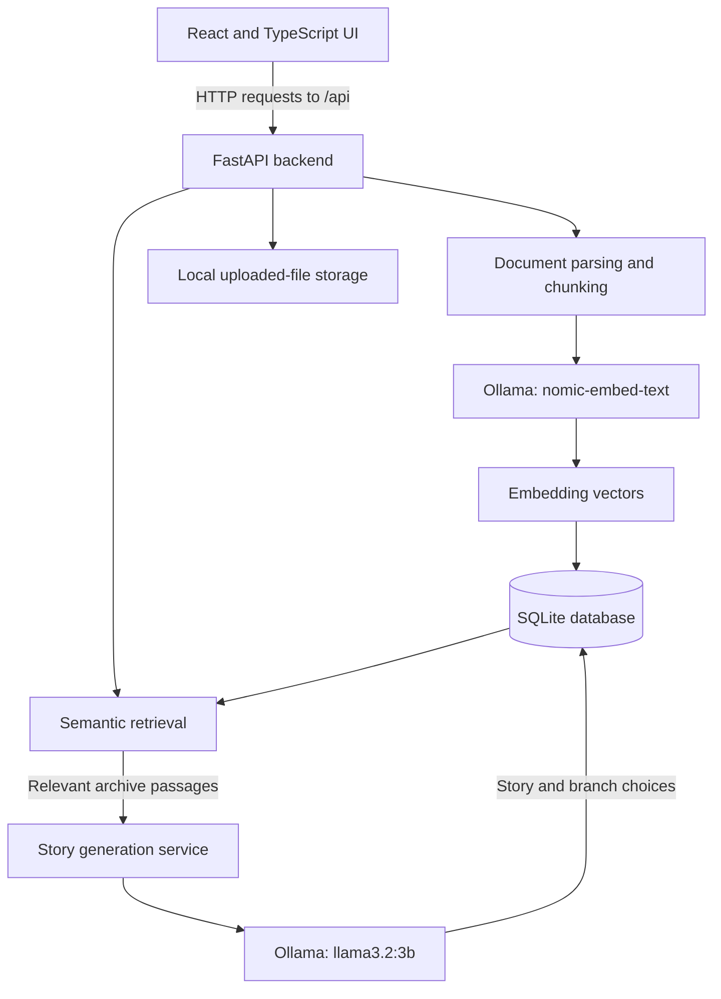

# The Midnight Archivist

> *A quiet place for stories that linger.*

**The Midnight Archivist** is a local-first literary archive and fiction-writing application. Import manuscripts and research documents, search them by meaning, and create atmospheric stories grounded in your archive—or write freeform fiction without source material.

The application uses a React frontend, a FastAPI backend, SQLite for local persistence, and Ollama to run the embedding and generation models on your own machine.

[](https://llama.meta.com/llama3/license/)
[](./LICENSE)
[](https://hacktoberfest.com/)

---

## Contents

- [Why The Midnight Archivist?](#why-the-midnight-archivist)
- [Features](#features)
- [Screenshots](#screenshots)
- [How it works](#how-it-works)
- [Technology stack](#technology-stack)
- [Requirements](#requirements)
- [Installation](#installation)
- [Using the application](#using-the-application)
- [Local data and privacy](#local-data-and-privacy)
- [Tests and build](#tests-and-build)
- [Known limitations](#known-limitations)
- [Project structure](#project-structure)
- [Contributing](#contributing)
- [Licensing and attribution](#licensing-and-attribution)

---

## Why The Midnight Archivist?

Writers, researchers, and archivists may want to work with unpublished manuscripts, private notes, diaries, or historical source material. Sending those documents to a hosted AI service is not always appropriate. General-purpose writing tools can also produce prose that is disconnected from the documents that inspired it.

The Midnight Archivist is designed around a local workflow:

1. Import your documents into a local archive.
2. Extract and divide their text into searchable passages.
3. Generate embeddings locally and retrieve relevant passages using semantic search.
4. Use retrieved passages as source material for a story, with references to the archive.
5. Continue the story through branching choices and export the resulting narrative.

The project was developed for Hacktoberfest 2026 and its **Ghost in the Machine** theme. Its literary atmosphere draws on forgotten observatories, night watchmen, coastal archives, and machines that seem to remember more than they should.

## Features

### Personal archive

- Import PDF, TXT, and Markdown (`.md`) files.
- Uploads are limited to 20 MB by default; the limit is configurable.
- Extract text from supported documents and retain available PDF page numbers and Markdown section context.
- Re-process documents to build or refresh their searchable index.
- Inspect extracted chunks from the Archive interface.

### Semantic search

- Create local text embeddings with `nomic-embed-text` through Ollama.
- Search indexed passages by meaning rather than exact keyword matches.
- Rank matching passages using cosine similarity.
- Narrow searches to selected documents.

### Story generation

- Generate stories grounded in selected archive documents.
- Generate freeform stories from a premise and atmosphere without archive sources.
- Choose from three length presets:

  | Preset | Target length |
  |---|---:|
  | Short | 400–600 words |
  | Medium | 800–1,200 words |
  | Long | 1,500–2,000 words |

- Use a multi-stage generation process for long stories.
- Apply length validation and bounded correction passes before saving generated stories.
- View source references for archive-grounded stories.

### Branching narratives and reading

- Continue a story through its available choices.
- Store continuations as branches linked to their parent story.
- Reconstruct and read the full narrative along a selected branch.
- Browse saved stories in the Story Shelf.
- Export stories as Markdown or plain text, or use the print stylesheet to save a PDF from the browser.

### Editorial interface

The interface uses warm paper tones, restrained accents, serif story typography, and a responsive layout designed around reading and writing rather than dashboard-style data density.

## Screenshots

| The Archive | Writing Desk |
|---|---|
|  |  |
| Import, process, search, and inspect archive documents. | Set a premise, atmosphere, length, and grounding mode. |

| Reading Room | Story Shelf |
|---|---|
|  |  |
| Read a complete narrative and follow its branches. | Browse saved stories and their continuations. |

| Settings | Mobile Archive |
|---|---|
|  |  |
| Check local service and storage status. | Use the archive on a compact viewport. |


## How it works

The frontend communicates with the FastAPI backend over HTTP. The backend manages document processing, retrieval, story generation, and persistence. Ollama provides local embedding and text-generation endpoints.



### Model responsibilities

| Model | Purpose |
|---|---|
| `nomic-embed-text` | Converts document passages and search queries into embeddings for semantic retrieval. |
| `llama3.2:3b` | Generates story content, outlines, and branching continuations. |

Both models are run locally through Ollama. The model names can be changed through the backend environment configuration, provided the selected models are compatible with the corresponding task.

## Technology stack

| Layer | Technologies |
|---|---|
| Frontend | React 18, TypeScript, Vite, React Router, Lucide React |
| Backend | Python 3.10/3.11, FastAPI, Pydantic, SQLAlchemy 2 |
| Database | SQLite with local file storage |
| Document processing | pypdf, Markdown and plain-text parsing |
| Retrieval | Ollama embeddings, NumPy cosine similarity |
| Local inference | Ollama, `nomic-embed-text`, `llama3.2:3b` |
| Testing | pytest, TypeScript compiler, Vite production build, Playwright browser checks |

## Requirements

Install the following before running the application:

- **Python:** 3.11 recommended (3.10 is also supported by the project configuration).
- **Node.js:** 18 LTS or newer, with npm.
- **Ollama:** [Install Ollama](https://ollama.com/).
- **Git:** Required to clone the repository.

The models must be downloaded once through Ollama. Model execution speed depends on the available CPU, memory, and GPU. A compatible GPU is useful but is not required by the application itself.

## Installation

The commands below use Windows PowerShell. For macOS or Linux, use the equivalent virtual-environment activation command for your shell.

### 1. Get the source code

Clone the GitHub repository, then open a terminal in the repository root:

```powershell
git clone <repository-url>
cd <repository-folder>
```

Replace the placeholders with the repository URL and directory name.

### 2. Install and prepare Ollama models

Install Ollama, then download the two models used by the default configuration:

```powershell
ollama pull nomic-embed-text
ollama pull llama3.2:3b
ollama list
```

Make sure the Ollama service is running before using embedding, search, or story-generation features. If it is not already running, start it with:

```powershell
ollama serve
```

Keep Ollama running while using the application.

### 3. Configure and start the backend

Open a PowerShell terminal at the repository root and run:

```powershell
Copy-Item backend\.env.example backend\.env
cd backend

python -m venv .venv
.\.venv\Scripts\Activate.ps1

python -m pip install --upgrade pip
pip install -r requirements.txt

uvicorn app.main:app --host 127.0.0.1 --port 8000 --reload
```

The backend reads its configuration from `backend/.env`. The default configuration uses:

- API host: `127.0.0.1`
- API port: `8000`
- SQLite database: `backend/data/archivist.db`
- Uploaded documents: `backend/data/uploads/`
- Ollama: `http://localhost:11434`

The database and data directories are initialized by the backend when it starts.

Useful backend URLs:

- Health check: [http://127.0.0.1:8000/api/health](http://127.0.0.1:8000/api/health)
- System status: [http://127.0.0.1:8000/api/system/status](http://127.0.0.1:8000/api/system/status)
- Interactive API documentation: [http://127.0.0.1:8000/api/docs](http://127.0.0.1:8000/api/docs)

### 4. Start the frontend

Open a **second** PowerShell terminal at the repository root:

```powershell
cd frontend
npm ci
npm run dev
```

Open [http://localhost:5173](http://localhost:5173) in your browser.

For the default development setup, the frontend sends API requests to `/api`, and the Vite development server proxies those requests to `http://127.0.0.1:8000`. A separate frontend environment file is not required for this default configuration.

## Using the application

1. **Start the local services.** Confirm Ollama is running and both required models are installed. Start the backend and frontend in separate terminals.
2. **Build your archive.** Open the Archive page and upload PDF, TXT, or Markdown documents.
3. **Index your documents.** Process each uploaded document so its text can be chunked and embedded.
4. **Search the archive.** Enter a natural-language query and inspect the relevant passages returned by semantic search.
5. **Create a story.** Open the Writing Desk, enter a premise, choose an atmosphere and length, then select archive-grounded or freeform generation.
6. **Read and branch.** Open the generated story in the Reading Room and select a continuation to create another narrative branch.
7. **Save or export.** Browse saved stories in the Story Shelf and export a narrative from the Reading Room.

## Local data and privacy

The default architecture keeps application data on the machine running the backend:

- SQLite database: `backend/data/archivist.db`
- Uploaded source files: `backend/data/uploads/`
- Embedding and generation requests: sent to the local Ollama service configured by `OLLAMA_BASE_URL` (default `http://localhost:11434`).

The application does not require a hosted AI API key. Initial setup does require internet access to install dependencies and download the Ollama models. Once the dependencies and models are available locally, the normal document-processing and AI workflow uses the local backend and Ollama services.

Keep private documents, the database, backups, and personal `.env` files out of public repositories. These files are excluded by the repository's `.gitignore`; check `git status` before committing.

## Tests and build

### Backend tests

The backend test suite uses mocked Ollama interactions and test databases for automated tests:

```powershell
cd backend
.\.venv\Scripts\Activate.ps1
pytest -v
```

The project's final verification report recorded **151 passing backend tests**.

### Frontend type check and production build

Run these commands from the `frontend` directory:

```powershell
npx tsc --noEmit
npm run build
```

The Vite build output is written to `dist-frontend/` at the repository root.

## Known limitations

- **Scanned PDFs:** PDF extraction reads embedded text. A scanned PDF without a text layer requires OCR before import; OCR is not built into the application.
- **Local model resources:** Generation speed and the practical model size depend on the machine's available CPU, RAM, and GPU resources.
- **Retrieval context:** Archive-grounded generation uses a limited set of retrieved passages. A source document may contain relevant information that is not included in the selected context for a particular prompt.
- **Model availability:** Embedding, semantic search, and generation require Ollama to be running and the configured models to be installed locally.

## Project structure

```text
.
├── backend/
│   ├── app/
│   │   ├── routers/          # Document, search, story, and system endpoints
│   │   ├── services/         # Parsing, chunking, indexing, retrieval, Ollama, story engine
│   │   ├── config.py         # Environment-based settings
│   │   ├── database.py       # SQLite setup
│   │   ├── models.py         # SQLAlchemy models
│   │   └── schemas.py        # Pydantic schemas
│   ├── tests/                # Backend automated tests
│   ├── requirements.txt
│   └── .env.example
├── frontend/
│   ├── src/
│   │   ├── components/       # Shared interface components
│   │   ├── pages/            # Archive, Writing Desk, Reading Room, Shelf, Settings
│   │   ├── services/         # Typed frontend API modules
│   │   ├── styles/           # Design tokens and application styles
│   │   └── types/            # TypeScript domain types
│   ├── package.json
│   └── vite.config.ts
├── screenshots/
│   └── final/                # Application screenshots
├── .env.example
├── .gitignore
├── CONTRIBUTING.md
├── LICENSE
├── README.md
└── THIRD_PARTY_NOTICES.md
```

## Contributing

Contributions are welcome from developers, writers, and digital archivists. Please read [CONTRIBUTING.md](./CONTRIBUTING.md) before opening an issue or pull request. The guide covers setup, code conventions, tests, branch naming, and pull-request expectations.

When contributing, do not commit:

- Personal `.env` files or credentials.
- SQLite database files, backups, or WAL/SHM files.
- Uploaded documents or other private source material.
- Virtual environments, `node_modules`, or generated build output.

## Licensing and attribution

The original application source code is licensed under the [MIT License](./LICENSE).

The default story-generation model is Meta's Llama 3.2 3B model. This project is **Built with Llama**. Llama model use is governed by the [Meta Llama 3.2 Community License](https://llama.meta.com/llama3/license/) and the [Meta Llama Acceptable Use Policy](https://llama.meta.com/use-policy/). The model is open-weight; its license is separate from the application's MIT license.

The embedding model, Ollama runtime, and application dependencies are distributed under their own licenses. See [THIRD_PARTY_NOTICES.md](./THIRD_PARTY_NOTICES.md) for the project’s third-party notices and attribution details.

---

*The Midnight Archivist — a quiet place for stories that linger.*
