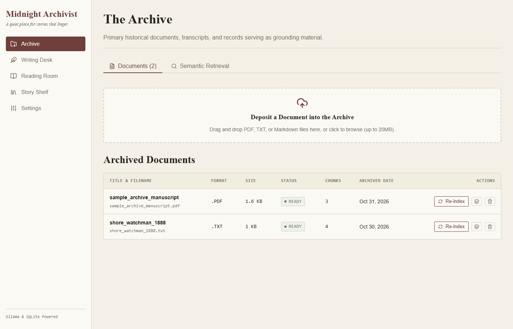
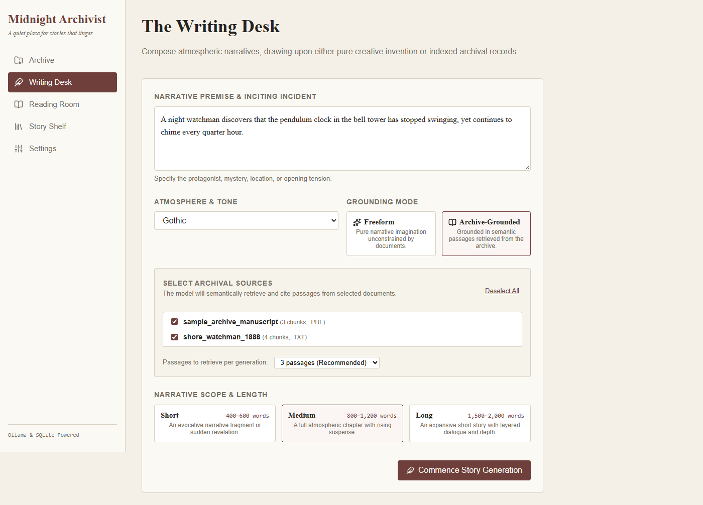
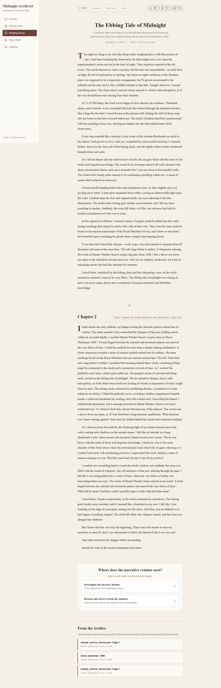
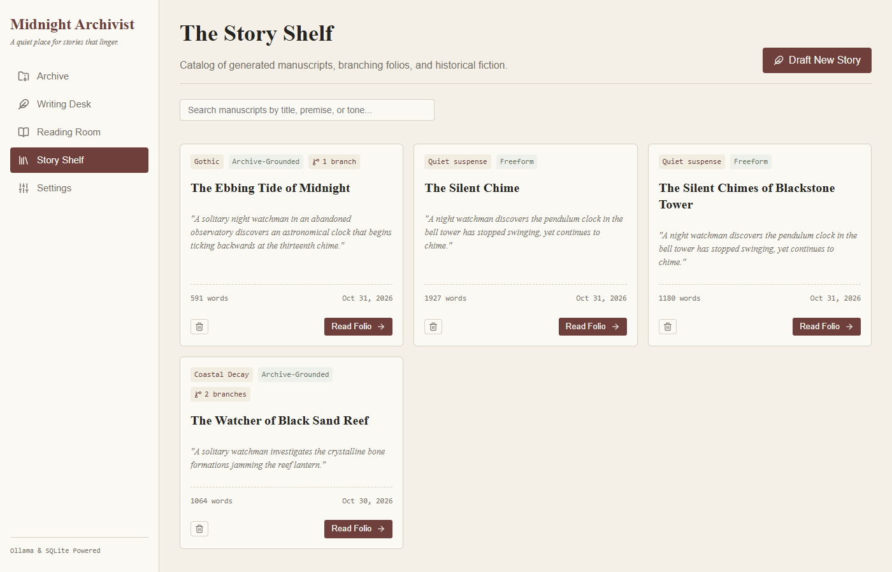
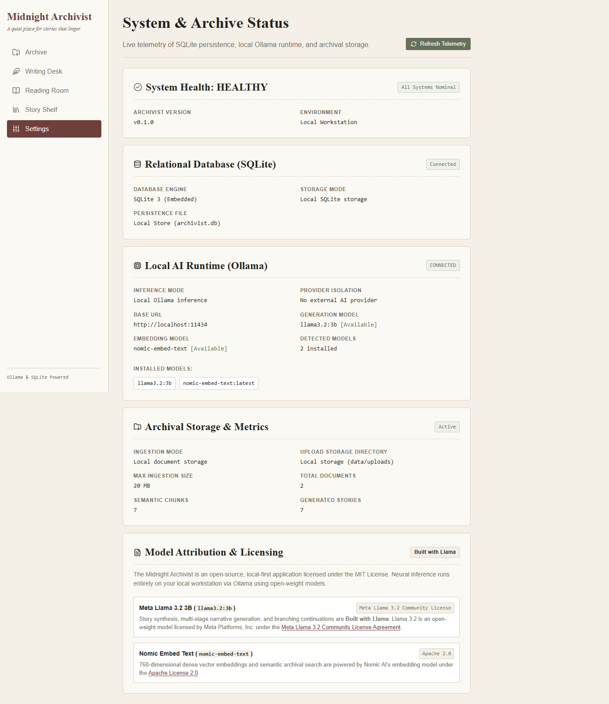
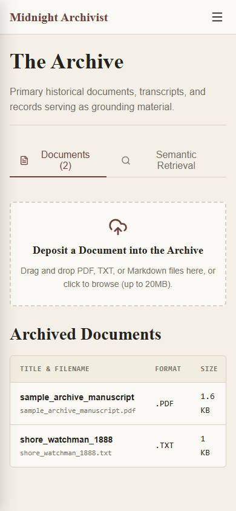
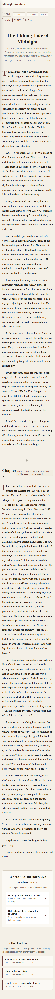
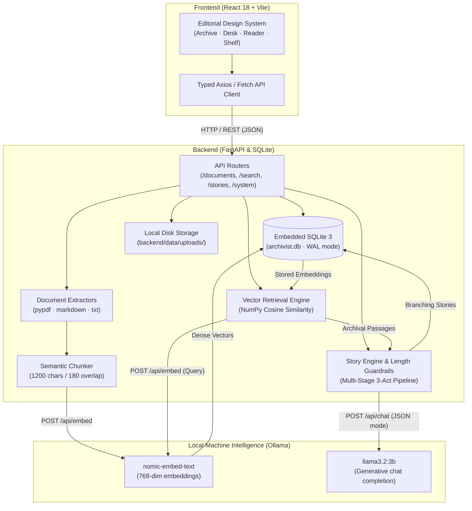

# The Midnight Archivist

> *"A quiet place for stories that linger."*

[](./backend/tests)
[](./frontend/tsconfig.json)
[](https://llama.meta.com/llama3/license/)
[](./LICENSE)
[](https://ollama.com)
[](https://hacktoberfest.com)

---

## 1. Project Introduction

**The Midnight Archivist** is a local-first literary archive and speculative fiction writing environment. It allows readers, writers, and archivists to deposit historical manuscripts, personal research, and primary source documents, index them using local neural embeddings, and craft branching narrative fiction grounded in the authentic texture of the archive—**completely offline**, powered exclusively by open-weight models via local Ollama inference.

### Problem Statement
Modern generative writing tools rely almost universally on closed proprietary cloud APIs. This architecture introduces severe compromises:
1. **Confidentiality Risks:** Writers and historians cannot safely ingest unpublished drafts, confidential diaries, or sensitive primary source material into cloud AI providers.
2. **Homogenized Voice:** Cloud LLMs often produce generic, predictable prose ungrounded in real historical artifacts.
3. **Fragile Ephemerality:** Cloud services change models, enforce intrusive filters, charge metered API fees, or shut down entirely, rendering past narratives uneditable or lost.

### Project Description
The Midnight Archivist restores agency to the author. Your documents remain permanently on your local disk in an embedded SQLite database. Text chunking, vector embedding, semantic retrieval, and narrative generation occur on your workstation hardware. The interface adheres to a quiet, bookish editorial aesthetic with warm paper palettes (`#F4F0E7`, `#FBF9F4`, `#25231F`), classic serif typography, and unhurried pacing.

### Hacktoberfest 2026: *Ghost in the Machine*
The project explores the ghost in the machine through two complementary facets:
- **Literary Theme:** Stories center on nocturnal watchmen, flooded observatories, forgotten salt-marsh beacons, and temporal anomalies where machines hum with unexplained memory.
- **Technical Architecture:** Instead of an unseen cloud oracle, the machine itself—the GPU in your personal workstation running local weights—becomes the literary engine, whispering continuations directly from the pages of the local archive.

---

## 2. Key Features

- **Private Archival Ingestion:** Drag-and-drop ingestion of `.pdf`, `.txt`, and `.md` manuscripts. Documents are parsed locally, preserving page numbers and section headers.
- **Semantic Text Chunking:** Sliding-window chunker with sentence and paragraph boundary awareness, preserving narrative context without mid-word cuts.
- **Local Neural Embeddings:** Generates 768-dimensional dense vector embeddings using `nomic-embed-text` running locally through Ollama.
- **Embedded Vector Retrieval:** In-memory cosine similarity search backed by relational SQLite storage, retrieving relevant archival fragments with cosine similarity scoring.
- **Archive-Grounded Story Generation:** Synthesizes retrieved fragments into atmospheric fiction, citing source manuscripts and page numbers in a dedicated archival appendix.
- **Freeform Fiction Mode:** Pure narrative creation from premise and atmosphere without archival constraints.
- **Strict Two-Sided Length Enforcement:** Hard minimum and maximum word count guardrails for **Short** (400–600w), **Medium** (800–1,200w), and **Long** (1,500–2,000w) presets, featuring bounded corrective expansion and compression passes.
- **Multi-Stage Long Story Pipeline:** Generates a structured 3-act outline followed by sequential section generation with narrative context passing and seamless boundary stitching.
- **Non-Linear Branching Narratives:** Multi-level tree persistence where readers can choose divergent paths at narrative thresholds. Full genealogical tree traversal allows reading complete multi-chapter chronicles along any branch.
- **Manuscript Exports:** Download full reconstructed stories as formatted Markdown (`.md`), plain text (`.txt`), or print-to-PDF with optimized print stylesheets.
- **Zero Cloud Leakage:** No external API keys, no cloud telemetry, and no remote font or CDN dependencies.

---

## 3. Interface Gallery

The application follows an editorial design language with warm paper tones, literary serif headings, generous whitespace, and muted accents.

| View | Screenshot | Description |
|---|---|---|
| **The Archive** |  | Document repository displaying indexed records, chunk counts, ready badges, chunk inspector, and semantic retrieval tab. |
| **Writing Desk** |  | Story configuration interface with premise formulation, atmosphere presets, scope selection (Short, Medium, Long), and grounding mode toggles. |
| **Reading Room** |  | Immersive book typography reader displaying chronological narrative segments (`❦` dividers), word count badges, export actions, and branch choices. |
| **The Story Shelf** |  | Catalog of root manuscripts, branch counts, title search filtering, and confirmation modals for manuscript deletion. |
| **Settings & Telemetry** |  | Real-time system diagnostics verifying SQLite persistence, Ollama runtime connection, and complete external provider isolation. |
| **Mobile Archive** |  | Responsive document table and slide-out navigation rail optimized for compact viewports. |
| **Mobile Reading Room** |  | Clean mobile reading layout with touch-friendly branching cards and responsive typography. |

---

## 4. System Architecture

The Midnight Archivist is designed as a modular decoupled system where the React frontend communicates with a FastAPI service, which orchestrates local storage and local Ollama inference.



### Separate Model Responsibilities
To optimize local resource usage and latency, the system delegates tasks to specialized open-weight models:
1. **Embedding Model (`nomic-embed-text`):** High-efficiency 768-dimensional embedding model optimized for long context (up to 8,192 tokens). Used during document ingestion and search query vectorization.
2. **Generative Language Model (`llama3.2:3b`):** 3-billion parameter instruction-tuned model. Generates structured JSON narrative payloads, story titles, and branching options with low VRAM footprint (~2.5 GB VRAM).

---

## 5. Installation & Setup Guide

### Prerequisites
- **Operating System:** Windows 10/11, macOS, or Linux.
- **Python:** Version 3.10 or 3.11 installed.
- **Node.js:** Version 18 LTS or 20 LTS.
- **Ollama:** Installed from [https://ollama.com](https://ollama.com).

### Step 1: Install and Launch Ollama

1. Open PowerShell and verify Ollama is installed:
   ```powershell
   ollama --version
   ```
2. Pull the required models:
   ```powershell
   ollama pull nomic-embed-text
   ollama pull llama3.2:3b
   ```
3. Ensure the Ollama service is running:
   ```powershell
   ollama serve
   ```

### Step 2: Clone and Configure Environment

```powershell
git clone https://github.com/<your-username>/midnight-archivist.git
cd midnight-archivist

# Copy environment configuration files
Copy-Item backend\.env.example backend\.env
Copy-Item frontend\.env.example frontend\.env
```

### Step 3: Backend Setup

```powershell
cd backend

# Create and activate Python virtual environment
python -m venv .venv
.\.venv\Scripts\Activate.ps1

# Upgrade pip and install dependencies
pip install --upgrade pip
pip install -r requirements.txt

# Start the FastAPI server
uvicorn app.main:app --host 127.0.0.1 --port 8000 --reload
```
The backend initializes `data/archivist.db` automatically on startup.  
Health check endpoint: [http://127.0.0.1:8000/api/health](http://127.0.0.1:8000/api/health)  
Interactive API docs: [http://127.0.0.1:8000/api/docs](http://127.0.0.1:8000/api/docs)

### Step 4: Frontend Setup

Open a separate PowerShell terminal:

```powershell
cd midnight-archivist\frontend

# Install dependencies
npm install

# Start Vite development server
npm run dev
```
Open your browser to: [http://localhost:5173](http://localhost:5173)

---

## 6. Running Automated Tests

### Backend Unit & Integration Tests (151 Tests)
All backend tests execute completely offline using deterministic mocked Ollama interactions and temporary databases:

```powershell
cd backend
.\.venv\Scripts\Activate.ps1
pytest -v
```

### Frontend Type Checking & Production Build
```powershell
cd frontend
npx tsc --noEmit
npm run build
```

---

## 7. Open Innovation & Architectural Philosophy

The Midnight Archivist was engineered as a proof of concept for **sovereign creative software**:

1. **True Local Document Sovereignty:** When you deposit diaries, historical letters, or unreleased prose into The Midnight Archivist, not a single byte leaves your workstation. No cloud server stores your prose, no third party trains on your words, and no vendor terms-of-service govern what themes you may explore.
2. **Deterministic Embedded Architecture:** Using standard SQLite and raw NumPy vector similarity means your entire database is a single portable file (`archivist.db`). There are no external vector database daemons, cloud clusters, or subscription keys to maintain.
3. **Model Interchangeability:** The generation client and prompt builder adhere to OpenAI-compatible chat completion semantics. Users can seamlessly switch to larger models (`llama3.1:8b`, `mistral:7b`, `qwen2.5:7b`) or alternative embedding models simply by modifying `backend/.env`.
4. **Offline Resilience:** The application functions with zero internet access, making it suitable for remote research, maritime field work, or distraction-free writing retreats.

---

## 8. Licenses & Model Attribution

### Application License
The Midnight Archivist application source code is licensed under the **MIT License**. See [LICENSE](./LICENSE) for the full license text.

```text
MIT License
Copyright (c) 2026 [COPYRIGHT HOLDER]
```
> **Notice for Project Owner:** Replace `[COPYRIGHT HOLDER]` in [LICENSE](./LICENSE) with your legal name or organization before public distribution. The application MIT license applies strictly to original application source code and does not alter the licenses of third-party models or dependencies.

### Model Attribution ("Built with Llama")
Story generation, structured outline expansion, and narrative branching continuations in The Midnight Archivist are:

> **Built with Llama**

The default generation engine utilizes the **Meta Llama 3.2 3B (`llama3.2:3b`)** open-weight model provided by Meta Platforms, Inc.
- **Model License:** Governed by the [Meta Llama 3.2 Community License Agreement](https://llama.meta.com/llama3/license/) (September 25, 2024).
- **License Classification:** Llama 3.2 is an **open-weight model**, not an unrestricted OSI-approved open-source license. Use is subject to the [Meta Llama Acceptable Use Policy](https://llama.meta.com/use-policy/) and monthly active user thresholds (<700M MAU).
- In accordance with Meta's license requirements, attribution is displayed in this documentation and in the application's **Settings & Telemetry** interface.

### Third-Party Model & Dependency Notices
This project integrates with local neural models via Ollama and uses open-source libraries. For full copyright notices, authoritative repository links, and transitive dependency licenses, consult [THIRD_PARTY_NOTICES.md](./THIRD_PARTY_NOTICES.md).

| Component | Provider / Author | License | Description / Scope |
|---|---|---|---|
| **`llama3.2:3b`** | Meta Platforms, Inc. | [Llama 3.2 Community License](https://llama.meta.com/llama3/license/) | Generative language model (Built with Llama). |
| **`nomic-embed-text`** | Nomic AI | [Apache-2.0](http://www.apache.org/licenses/LICENSE-2.0) | 768-dimensional neural dense embeddings. |
| **Ollama Runtime** | Jeffrey Morgan & Contributors | [MIT](https://github.com/ollama/ollama/blob/main/LICENSE) | Local inference server daemon. |
| **FastAPI** | Sebastián Ramírez | [MIT](https://github.com/fastapi/fastapi/blob/master/LICENSE) | High-performance Python backend framework. |
| **SQLAlchemy** | Michael Bayer & Contributors | [MIT](https://github.com/sqlalchemy/sqlalchemy/blob/main/LICENSE) | Relational SQL toolkit and ORM. |
| **React** | Meta Platforms, Inc. | [MIT](https://github.com/facebook/react/blob/main/LICENSE) | Frontend user interface library. |
| **Vite** | Evan You & Contributors | [MIT](https://github.com/vitejs/vite/blob/main/LICENSE) | Next-generation frontend bundler and dev server. |
| **Lucide Icons** | Lucide Contributors | [ISC](https://github.com/lucide-icons/lucide/blob/main/LICENSE) | Editorial iconography suite. |

---

## 9. Known Limitations

- **Hardware Requirements:** Local neural generation requires adequate hardware. A modern multi-core CPU and at least 8 GB of RAM can run `llama3.2:3b` (via CPU quantization), but an NVIDIA GPU with 6+ GB VRAM is recommended for optimal generation speeds (~15–20 seconds per chapter).
- **OCR Limitations:** Document extraction parses digital text from PDFs, plain text, and Markdown. Scanned document images without embedded OCR text layers will not yield text chunks unless pre-processed with an external OCR tool.
- **Context Boundaries:** While `nomic-embed-text` supports up to 8k tokens, the generation engine limits retrieved archive passages to the top-k most relevant chunks (default 5 chunks, ~1,500 tokens) to prevent prompt dilution and fit within smaller model context windows.

---

## 10. Contributing

Contributions are warmly welcomed! Please review our [Contributing Guide](./CONTRIBUTING.md) for details on our workflow, coding standards, and branch conventions.

---

## 11. Acknowledgments

Created for Hacktoberfest 2026's *Ghost in the Machine* challenge. Special thanks to the open-source communities behind Ollama, Meta Llama, Nomic AI, FastAPI, and React.
